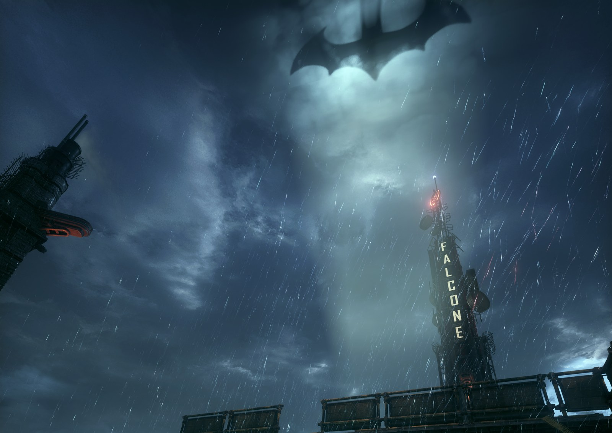
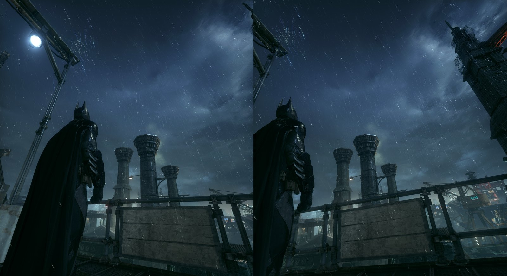

  

# Batman: Arkham Knight VR

Batman: Arkham Knight in PC VR, with per-eye DLSS, an AFW speed mode, and OpenXR for Virtual Desktop and SteamVR. The
game draws both eyes itself, every frame, from the same moment (native stereo), so depth is correct and nothing lags
behind when the camera swings.

## What you get

- **DLSS for each eye** (NVIDIA RTX graphics cards): each eye is drawn smaller and upscaled by NVIDIA's DLSS, which
  also gives clean anti-aliasing. Choose the quality in the VR menu.
- **AFW (alternate frame warping)**, a choice in the VR menu beside full native stereo: the game draws one eye per
  frame and the other eye is built from that same frame, so both eyes still show the same moment. More frames per
  second on slower PCs.
- **OpenXR, with Virtual Desktop and SteamVR**: runs on your PC VR software's own OpenXR runtime (no extra layers or
  injectors). A separate SteamVR shortcut starts the game through SteamVR without changing your PC's VR settings.
- **Native stereo 3D** with full head tracking (look around and lean in), on the game's own third-person camera.

  

- **HUD on a panel in front of you**; the distance marker and the grapple reticle sit on their targets, at the
  target's depth, and turn only with the game camera.
- **Menus, the map and loading screens** on a large screen in the room; the main menu in live 3D.
- **An in-headset VR menu**: hold both thumbsticks down (or press F8). World scale, DLSS, HUD size and distance, render
  size, comfort options, and more. Settings are saved.

## What you need

- **Batman: Arkham Knight** on Steam, on Windows 10 or 11.
- **A PC VR headset and the software you use for PC VR games** (for example Virtual Desktop, SteamVR or the Meta Quest
  Link app).
- **A gamepad.** Quest Touch controllers work through Virtual Desktop, which presents them as a gamepad.

Tested with: Quest 3 through Virtual Desktop, RTX 4070 Ti. A SteamVR launcher is included and was tested with SteamVR.

## Installing

1. Start the game once from Steam as normal, wait for the main menu, and quit (this makes the game's settings files).
2. Download `AKVR-ArkhamKnight.zip` from [Releases](../../releases) and unpack it anywhere (7-Zip works). Most of its
   size is NVIDIA's DLSS library; the mod itself is a few MB.
3. Double-click `Install-AKVR.bat`. If Windows SmartScreen appears: More info, then Run anyway. The installer puts
   everything into the game folder; you don't copy anything there yourself. An older version of this mod is updated in
   place.
4. Start your PC VR software and make sure it is the active OpenXR runtime (Virtual Desktop and SteamVR each have a
   setting for this).
5. Start the game with the **Batman Arkham Knight (VR)** shortcut on your desktop. To play through SteamVR instead, use
   **Batman Arkham Knight (VR, SteamVR)**. Starting the game from Steam plays it normally, on your monitor.

The installer saves your own graphics settings first; VR uses its own copy of them, so the normal game keeps yours.

## In the game

| | |
|---|---|
| VR menu | hold both thumbsticks down for half a second, or F8 |
| Recenter | hold the headset's menu / Meta button, or F12 |
| Save a picture of both eyes | F2 |

## If something is wrong

| What you see | What to do |
|---|---|
| Nothing in the headset, the game plays on the monitor | Start your PC VR software before the game, make it the active OpenXR runtime, and start the game from the Batman Arkham Knight (VR) shortcut. |
| Low frame rate | VR menu: pick a faster DLSS setting, lower the picture size, or turn on AFW. |
| No DLSS (graphics card without NVIDIA RTX) | VR menu: DLSS Off, and lower the picture size. |
| The world feels too big or too small | VR menu: world scale. |

## Removing it

Run **Uninstall Batman Arkham Knight VR** from the Start menu (or `Uninstall-AKVR.bat` in the game folder). It removes
the mod and the shortcuts, puts your game settings back as they were, and deletes the mod's own VR settings and logs.

## Credits

Built with MinHook, Dear ImGui, the OpenXR SDK and SMAA. The per-eye DLSS method follows the
[Luma Framework](https://github.com/Filoppi/Luma-Framework)'s Arkham Knight mod (licence:
[LICENSE-luma-framework.md](LICENSE-luma-framework.md)). DLSS is NVIDIA's. Full list:
[THIRD_PARTY_NOTICES.md](THIRD_PARTY_NOTICES.md).
The picture at the top is the game's own Steam store artwork, shown from Steam (Batman: Arkham Knight © Warner Bros.
Entertainment, Batman and all characters © DC); it is not part of this repository.

Batman: Arkham Knight © Warner Bros. Entertainment Inc. Batman and related characters are trademarks of DC Comics. This
is an unofficial fan mod and needs your own copy of the game.
